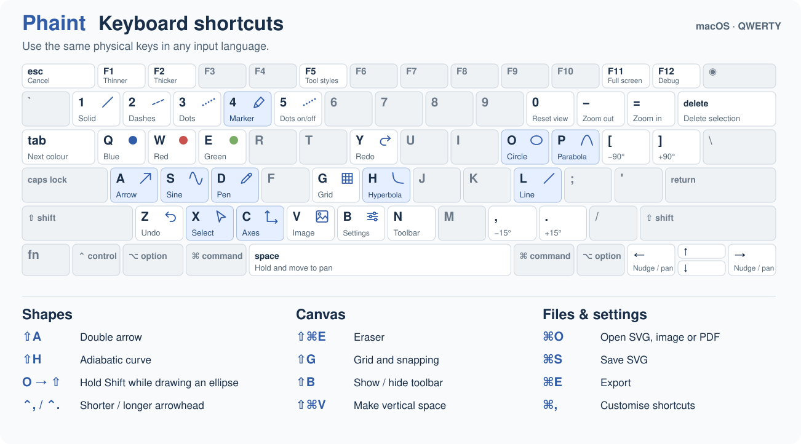

# Phaint

[Русская версия](README.ru.md) · [Download for macOS](https://github.com/pozitron57/phaint/releases/latest)

Phaint is a vector whiteboard for teaching online. Write on an infinite canvas with a pressure-sensitive pen, sketch a graph as you explain it, and share the board with your students.

- Draw coordinate axes, parabolas, hyperbolas, sine waves, arrows, straight lines, circles and ellipses with dedicated tools.
- Set the grid spacing and snap shapes to it. Paste images and align their edges.
- Open and edit SVGs from other apps. Select individual paths, move, rotate, resize or flip objects. Complex artwork stays together as a vector object.
- Annotate PDFs and export the whole board or a selection to SVG, PDF, PNG or JPG.
- Customise every keyboard shortcut, including the modifiers you hold while drawing.

**Install** on macOS 13 Ventura or later, on Apple silicon or Intel. Open the universal DMG and drag Phaint into Applications. The interface is in Russian. The guide covers the first-launch prompt. [Installation and user guide](docs/GUIDE.md)

[User guide](docs/GUIDE.md) · [Technical specification in Russian](docs/SPEC.md) · [AGPL-3.0-or-later](LICENSE)
