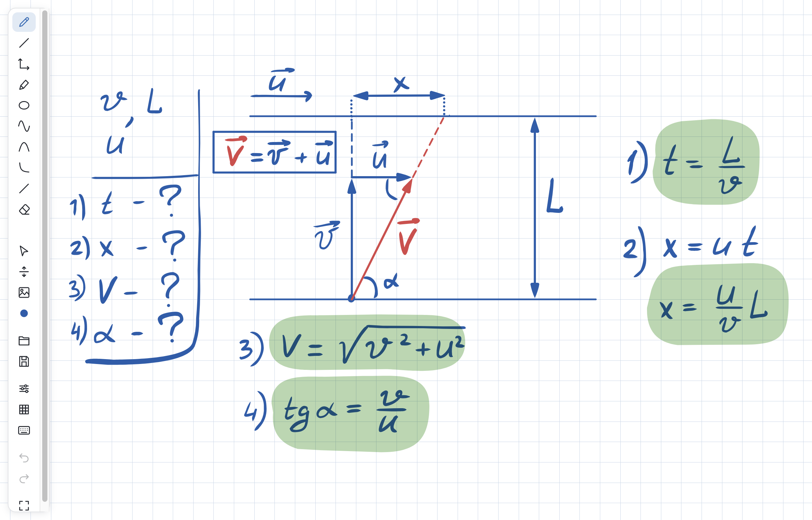

# Phaint

[Русская версия](README.ru.md) · [Download for macOS](https://github.com/pozitron57/phaint/releases/latest)

Phaint (physical paint) is a vector whiteboard for online teaching. Inspired by MyPaint and Xournal++, it includes drawing tools for physics teachers.

https://github.com/user-attachments/assets/031d23c6-f419-401b-a1b4-3d7bff75437d

- Draw on an infinite canvas.
- Assign your preferred keyboard shortcut to any tool.
- Open and edit SVGs from other apps. Move, rotate or stretch individual objects.
- Paste images from the clipboard.
- Adjust how strongly pen pressure affects line width on a graphics tablet.
- Draw freehand, erase and highlight. Dedicated tools cover coordinate axes, parabolas, hyperbolas, sine waves, arrows, straight lines, Bézier curves, circles and ellipses.
- Adjust the grid spacing and snap objects to grid intersections.
- Annotate PDFs.
- Export the whole board or a selection to SVG, PDF, PNG or JPG. Adjust SVG and PDF compression to keep files small.

| Adding velocities | A wheel rolling without slipping |
| --- | --- |
|  |  |

**Installation.** Phaint runs on Apple silicon and Intel Macs with macOS 13 Ventura or later.
Open the DMG and drag Phaint into Applications.
[Installation and user guide](docs/GUIDE.md)

[Add a language](docs/GUIDE.md#add-a-language)

[User guide](docs/GUIDE.md) · [Technical specification in Russian](docs/SPEC.md) · [AGPL-3.0-or-later](LICENSE)
