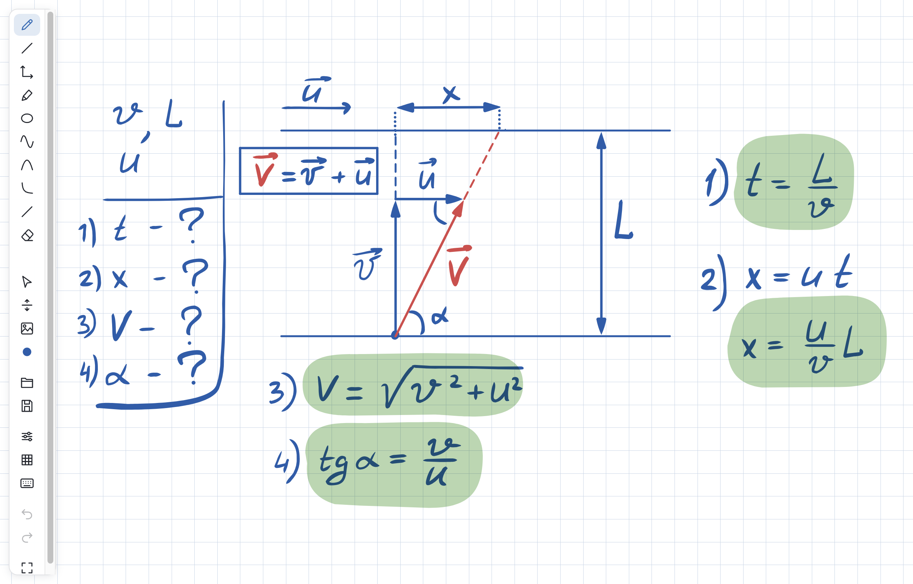
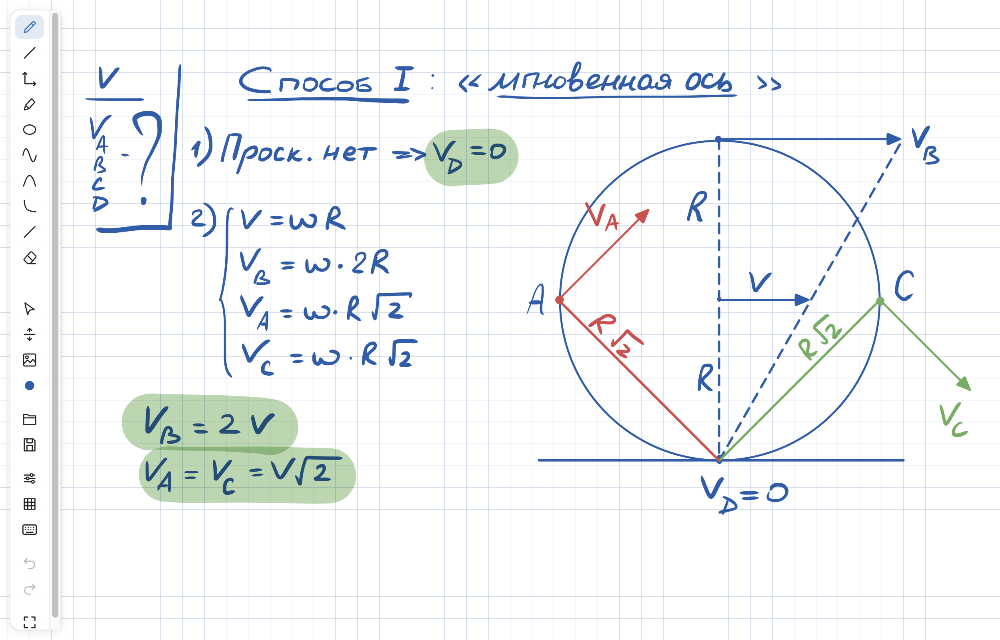
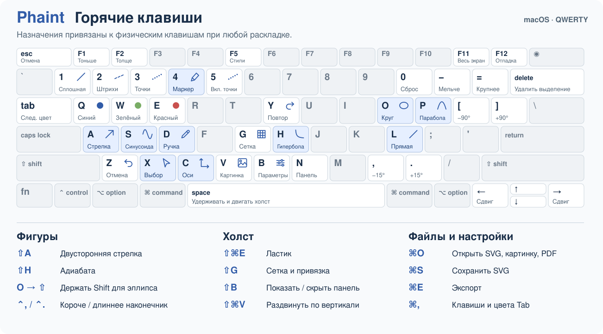

# Phaint

[English](README.md) · [Скачать для macOS](https://github.com/pozitron57/phaint/releases/latest)

Phaint (physical paint) — векторная доска-рисовалка для преподавания онлайн.
По мотивам MyPaint и xournal++.
Набор инструментов и возможностей подойдет для преподавателей физики.

https://github.com/user-attachments/assets/031d23c6-f419-401b-a1b4-3d7bff75437d

- Бесконечный холст.
- Любому инструменту можно назначить любую комбинацию клавиш.
- Открытие и редактирование SVG из других программ. Объекты можно переместить, повернуть, растянуть.
- Вставка картинки из буфера обмена.
- Поддержка нажатия от планшета, гибкие настройки толщины линии от силы нажатия.
- Инструменты: ручка, ластик, координатные оси, параболы, гиперболы, синусоиды, стрелки, прямые, кривые Безье, окружности, эллипсы, маркер-выделитель.
- Настраиваемая сетка и «прилипание» объектов к узлам.
- Пометки поверх PDF.
- Экспорт документа или выделения в SVG, PDF, PNG и JPG. Настройки для сжатия SVG и PDF, выходные файлы получаются небольшого размера.

| Сложение скоростей | Качение колеса без проскальзывания |
| --- | --- |
|  |  |

**Установка.** Подходит для macOS 13 Ventura и новее на Apple Silicon и Intel.
Откройте DMG-файл и перетащите Phaint в «Приложения».
[Установка и руководство](docs/GUIDE.ru.md)

[Как добавить язык](docs/GUIDE.ru.md#как-добавить-язык)

[Руководство пользователя](docs/GUIDE.ru.md) · [Подробное описание инструментов и форматов](docs/SPEC.md) · [Лицензия AGPL-3.0-or-later](LICENSE)
